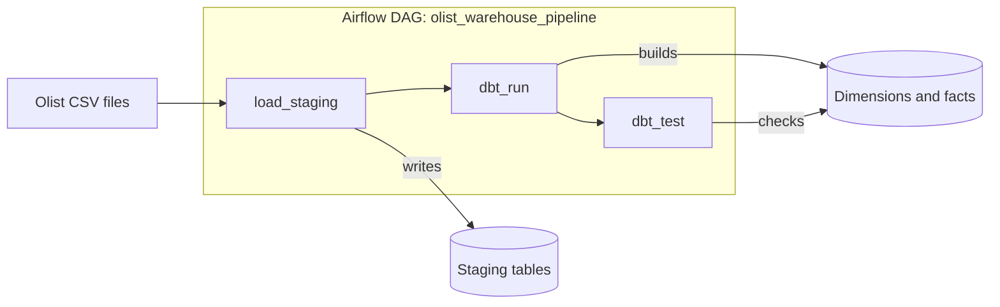
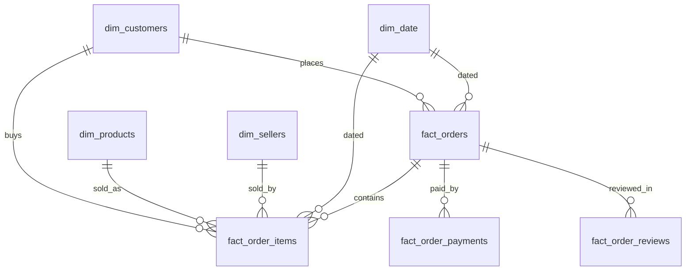
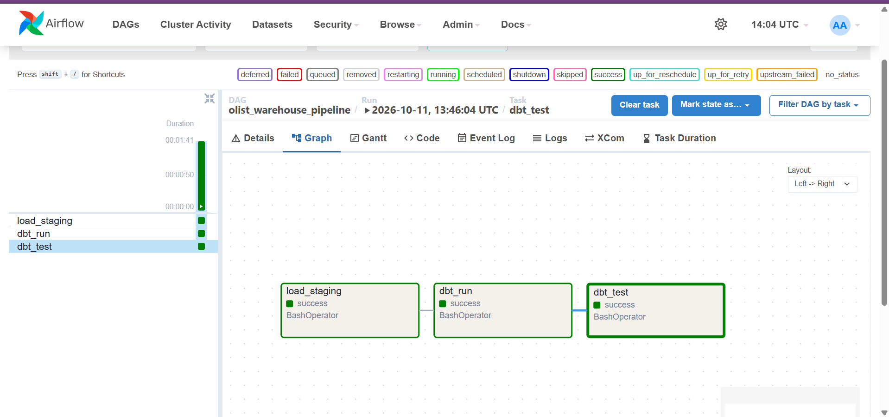

# Olist E-commerce Data Warehouse

An end-to-end data engineering project. It loads the public **Olist Brazilian e-commerce dataset** (about 100,000 orders, 2016 to 2018) into PostgreSQL, models it as a **star-schema warehouse with dbt**, checks it with **32 automated tests**, and runs the whole pipeline on **Airflow in Docker**, started with a single `docker compose up`.

## Architecture



| Step | What it does | Tool |
|---|---|---|
| Load | Reads 8 CSVs into staging tables | Python, pandas, SQLAlchemy |
| Transform | Builds dimensions and facts | dbt Core |
| Test | 32 data-quality tests | dbt tests |
| Orchestrate | Runs the steps in order, stops on failure | Airflow 2.10.4 |
| Package | Everything runs with one command | Docker Compose |

## Data model



| Fact table | Grain (one row is...) |
|---|---|
| `fact_orders` | one order |
| `fact_order_items` | one product line within an order |
| `fact_order_payments` | one payment transaction |
| `fact_order_reviews` | one review |

## Design decisions

- **Four fact tables**, because the grains differ. Mixing them in one table would multiply rows and inflate sums.
- **`fact_order_items` carries `customer_key` and `purchase_date_key` directly**, so common questions need fewer joins.
- **LEFT JOINs plus row-count reconciliation.** An INNER JOIN silently drops rows, so every fact is reconciled against staging.
- **Reviews use a surrogate key**, because `review_id` is not unique in the source data.
- **`date_key` is `YYYYMMDD`** (an integer that is readable and sortable).
- **`delivery_delay_days` = delivered minus estimated.** Negative means early, NULL means not delivered.
- **`TRUNCATE` inside one transaction** instead of replacing tables, so a failed load never leaves empty tables.
- **`schedule=None`**, because the dataset is a static snapshot. Runs are triggered manually.
- **No task retries.** A failure in a deterministic pipeline should be seen, not hidden.
- **dbt runs in its own virtualenv** inside the Airflow image, to avoid dependency conflicts.
- **No secrets in the repo.** Passwords come from environment variables (`.env` is git-ignored).

## Validation

`dbt test`: **32 passed, 0 warnings, 0 errors.** The pipeline has run successfully three times end to end.

- `unique` and `not_null` on every key
- `relationships` on every foreign key (paired with `not_null`, because `relationships` ignores NULLs)
- `accepted_values` on `review_score` (1 to 5)
- Surrogate-key tests pass by construction, so they guard against regressions rather than prove correctness.

Row counts reconciled against staging:

| Table | Rows |
|---|---|
| orders | 99,441 |
| order items | 112,650 |
| payments | 103,886 |
| reviews | 99,224 |

## Example analysis

### Monthly revenue (BRL)

```sql
SELECT d.year, d.month, ROUND(SUM(f.price)::numeric, 2) AS revenue
FROM fact_order_items f
JOIN dim_date d ON f.purchase_date_key = d.date_key
GROUP BY d.year, d.month
ORDER BY d.year, d.month;
```

<details>
<summary>Full results (24 months)</summary>

| Month | Revenue |
|---|---:|
| 2016-09 | 267.36 |
| 2016-10 | 49,507.66 |
| 2016-12 | 10.90 |
| 2017-01 | 120,312.87 |
| 2017-02 | 247,303.02 |
| 2017-03 | 374,344.30 |
| 2017-04 | 359,927.23 |
| 2017-05 | 506,071.14 |
| 2017-06 | 433,038.60 |
| 2017-07 | 498,031.48 |
| 2017-08 | 573,971.68 |
| 2017-09 | 624,401.69 |
| 2017-10 | 664,219.43 |
| 2017-11 | 1,010,271.37 |
| 2017-12 | 743,914.17 |
| 2018-01 | 950,030.36 |
| 2018-02 | 844,178.71 |
| 2018-03 | 983,213.44 |
| 2018-04 | 996,647.75 |
| 2018-05 | 996,517.68 |
| 2018-06 | 865,124.31 |
| 2018-07 | 895,507.22 |
| 2018-08 | 854,686.33 |
| 2018-09 | 145.00 |

</details>

- **November 2017 peaks at about 1.01M BRL**, most likely Black Friday.
- **2018 plateaus at roughly 0.85 to 1.0M BRL per month.**
- **The edge months (2016-09/12, 2018-09) are dataset boundaries, not collapses.** There is no data at all for November 2016.

### Delivery performance by state (top 10 by % late)

| State | Delivered orders | Avg days vs estimate | % late |
|---|---:|---:|---:|
| AL | 397 | -8.7 | 21.4 |
| MA | 717 | -9.6 | 17.4 |
| SE | 335 | -10.0 | 15.2 |
| PI | 476 | -11.3 | 13.9 |
| CE | 1,279 | -10.8 | 13.8 |
| RR | 41 | -17.3 | 12.2 |
| BA | 3,256 | -10.8 | 12.2 |
| RJ | 12,353 | -11.8 | 12.1 |
| PA | 946 | -14.1 | 11.2 |
| ES | 1,995 | -10.5 | 10.7 |

- All averages are negative: Olist's delivery estimates are conservative, so most orders arrive early.
- 6 of the 10 worst states are in the Northeast.
- RR has only 41 orders, so its figure is unreliable.
- RJ has by far the largest volume, so its 12.1% late rate affects the most customers.

## Screenshots



## Run it yourself

1. Clone this repo.
2. Download the dataset from [Kaggle](https://www.kaggle.com/datasets/olistbr/brazilian-ecommerce) and put the 8 CSV files in `data/` (the geolocation file is unused).
3. Copy `airflow/.env.example` to `airflow/.env` and set a password.
4. Start everything:
   ```bash
   cd airflow
   docker compose up -d --build
   ```
5. Open http://localhost:8080 (user `airflow`, password `airflow`). The DAG starts **paused**: turn it on, then trigger it.
6. Verify:
   ```bash
   docker exec -it olist_warehouse_db psql -U postgres -d postgres -c "SELECT COUNT(*) FROM fact_order_items"
   ```
   It should return `112650`.

## Project structure

```text
olist-ecommerce-warehouse/
  load_staging.py          # CSV -> staging tables
  olist_warehouse/         # dbt project
    models/staging/        # 7 cleaned views + sources.yml
    models/marts/          # dimensions, facts, schema.yml (32 tests)
    profiles.yml           # reads credentials from env vars
  airflow/
    Dockerfile             # Airflow + dbt in its own venv
    docker-compose.yaml    # Airflow + warehouse Postgres
    dags/olist_pipeline.py # load_staging >> dbt_run >> dbt_test
    .env.example
  data/                    # git-ignored, put the CSVs here
  docs/images/             # screenshots
```

## Known limitations and next steps

- All models are views. Large tables would be materialized as tables or incrementally.
- Each run is a full reload. An incremental load is the natural next step.
- `dim_customers` is per `customer_id`, not per person (`customer_unique_id`).
- Geolocation data is not modelled.
- No CI yet (planned: run `dbt test` on every push with GitHub Actions).

## Data attribution

Data: [Brazilian E-Commerce Public Dataset by Olist](https://www.kaggle.com/datasets/olistbr/brazilian-ecommerce) on Kaggle. Check the license on that page before reuse. The dataset is not included in this repo.

Built by Zainab.

